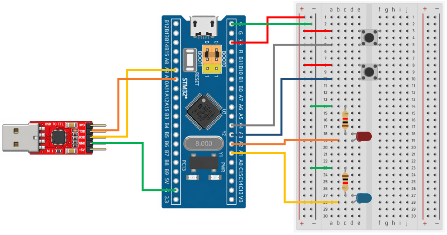

# FreeRTOS Project - Task Suspend

這是一個基於 STM32F103C8T6 微控制器的 FreeRTOS 示例專案，使用 STM32 HAL 庫展示如何暫停與恢復任務，並透過 LED 閃爍及按鍵操作，了解 FreeRTOS 的基本任務管理與排程機制

## 硬體需求

- STM32F103C8T6 微控制器 x1
- ST-Link 燒錄器
- USB-TTL 模組（專案使用 CP2102 模組）
- LED x2
- 220Ω 電阻 x2
- 按鈕 x2

## 軟體需求

- VSCode
- STM32CubeMX
- ARM GNU Toolchain
- CMake + Ninja
- STM32 HAL Library
- FreeRTOS
- 序列埠監控軟體（例如：串口調試助手）

## 電路圖

## 構建和編譯

1. 使用 VSCode 開啟專案資料夾
2. 確認 ARM GNU Toolchain 與 CMake 環境已正確設定
3. 執行 CMake Configure
4. 執行 Build
5. 使用 ST-Link 將程式燒錄至 STM32F103C8T6

## 使用方法

將程式燒錄至 STM32F103C8T6，開啟序列埠監控軟體。程式啟動後，LED1 與 LED2 每隔 500 ms 翻轉一次。按下 KEY1 時，系統將暫停 Task1，使 LED1 停止閃爍；按下 KEY2 時，系統將恢復 Task1，使 LED1 恢復閃爍。

## 任務介紹

- **Start Task**

  負責建立 Task1、Task2 與 Task3

- **Task1**

  控制 LED1 每隔 500 ms 翻轉一次

- **Task2**

  控制 LED2 每隔 500 ms 翻轉一次

- **Task3**

  偵測 KEY1 與 KEY2 的按下狀態，透過 KEY1 暫停 Task1，透過 KEY2 恢復 Task1，並使用軟體消抖避免誤觸發

## 功能介紹

- **任務暫停**

  將指定任務切換至 Suspended 狀態，使其暫時停止參與 FreeRTOS 排程。任務所配置的 Stack 與 TCB 仍然保留，不會被釋放

- **任務恢復**

  將處於 Suspended 狀態的任務切換至 Ready 狀態，使其重新參與 FreeRTOS 排程，無須重新建立任務