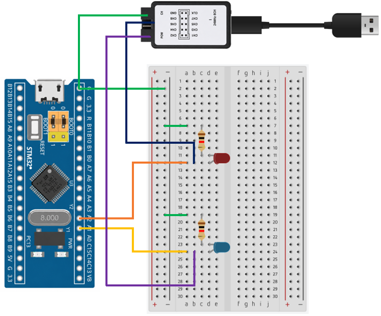
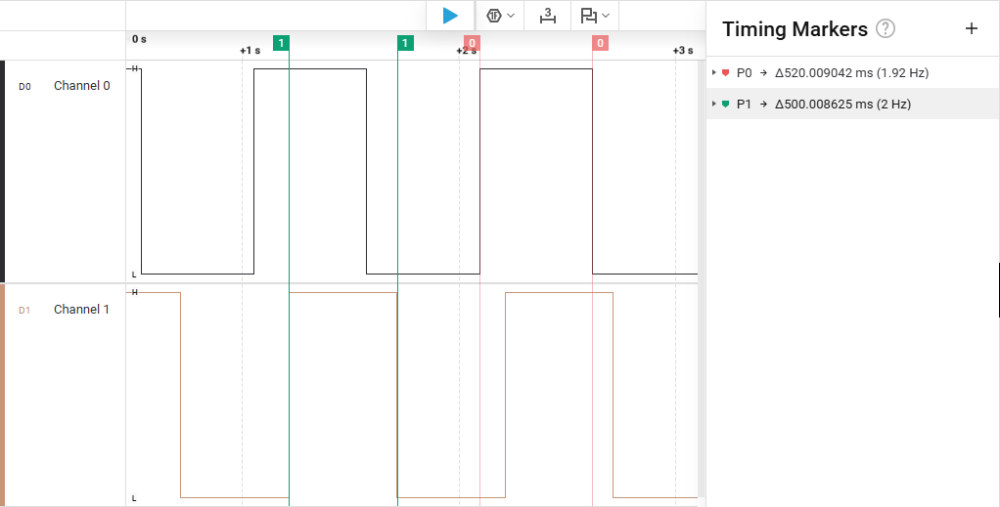

# FreeRTOS Project - Delay Time

這是一個基於 STM32F103C8T6 微控制器的 FreeRTOS 示例專案，展示相對時間延遲與固定週期延遲的差異，並透過邏輯分析儀觀察任務執行週期與累積時間偏移

## 硬體需求

- STM32F103C8T6 微控制器 x1
- ST-Link 燒錄器
- USB-TTL 模組（專案使用 CP2102 模組）
- LED x2
- 220Ω 電阻 x2
- 邏輯分析儀

## 軟體需求

- VSCode
- STM32CubeMX
- ARM GNU Toolchain
- CMake + Ninja
- STM32 HAL Library
- FreeRTOS
- 邏輯分析儀軟體

## 電路圖

## 構建和編譯

1. 使用 VSCode 開啟專案資料夾
2. 確認 ARM GNU Toolchain 與 CMake 環境已正確設定
3. 執行 CMake Configure
4. 執行 Build
5. 使用 ST-Link 將程式燒錄至 STM32F103C8T6

## 使用方法

將程式燒錄至 STM32F103C8T6，程式啟動後，LED1 與 LED2 分別透過相對時間延遲與固定週期延遲函式控制閃爍，兩個任務皆使用 `HAL_Delay()` 模擬任務處理時間。將邏輯分析儀的 CH0 與 CH1 分別連接至 PA1 與 PA2，透過邏輯分析儀軟體擷取 GPIO 訊號波形，量測兩個任務的執行週期及累積時間偏移

## 任務介紹

- **Start Task**

  負責建立 Task1 與 Task2

- **Task1**

  控制 LED1 翻轉，模擬 20 ms 任務處理時間，並實現相對時間延遲 500 ms，使任務實際執行週期約為 520 ms

- **Task2**

  控制 LED2 翻轉，模擬 20ms 任務處理時間，並實現固定週期 500 ms，使任務處理時間不會造成週期累積偏移

## 功能介紹

- **相對時間延遲**

  使用 `vTaskDelay()`，以函式呼叫當下的 Tick Count 為基準，計算任務的下一次喚醒時間

- **固定週期延遲**

  使用 `xTaskDelayUntil()`，以上一次預定喚醒時間為基準，計算下一次預定喚醒時間

## 實驗結果

