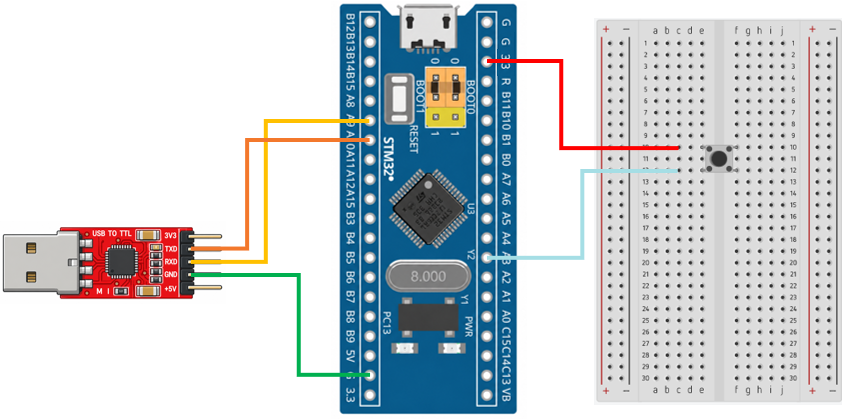

# FreeRTOS Project - Queue

這是一個基於 STM32F103C8T6 微控制器的 FreeRTOS 示例專案，展示如何透過 Queue 實現任務間通訊與資料傳遞

## 硬體需求

- STM32F103C8T6 微控制器 x1
- ST-Link 燒錄器
- USB-TTL 模組（專案使用 CP2102 模組）
- 按鈕 x1

## 軟體需求

- VSCode
- STM32CubeMX
- ARM GNU Toolchain
- CMake + Ninja
- STM32 HAL Library
- FreeRTOS
- 序列埠監控軟體（例如：串口調試助手）

## 電路圖

## 構建和編譯

1. 使用 VSCode 開啟專案資料夾
2. 確認 ARM GNU Toolchain 與 CMake 環境已正確設定
3. 執行 CMake Configure
4. 執行 Build
5. 使用 ST-Link 將程式燒錄至 STM32F103C8T6

## 使用方法

將程式燒錄至 STM32F103C8T6，並透過 USB-TTL 模組連接電腦，開啟序列埠監控軟體。當按下 KEY 時，傳送任務將資料寫入 Queue，接收任務從 Queue 中讀取資料，並透過 UART 印出收到的數值

## 任務介紹

- **Start Task**

  負責建立 Task1 與 Task2

- **Task1**

  負責偵測 KEY 的按鍵狀態，當按下 KEY 時，將數值寫入 Queue，並於傳送成功後印出 `Send Success`

- **Task2**

  負責等待並讀取 Queue 中的訊息，當成功接收資料後，透過 UART 印出收到的數值

## 功能介紹

- **Queue 資料傳送**

   使用 `xQueueSend()` 將資料寫入 Queue 尾端，實現任務間的資料傳遞

- **Queue 資料接收**

  使用 `xQueueReceive()` 從 Queue 前端讀取並移除資料，實現 FIFO。如果 Queue 為空，阻塞等待資料到達