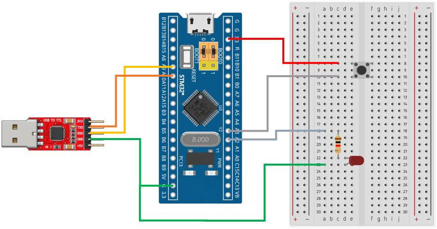

# FreeRTOS Project - Binary Semaphore

這是一個基於 STM32F103C8T6 微控制器的 FreeRTOS 示例專案，展示如何透過 Binary Semaphore 實現任務間同步

## 硬體需求

- STM32F103C8T6 微控制器 x1
- ST-Link 燒錄器
- USB-TTL 模組（專案使用 CP2102 模組）
- 按鈕 x1
- LED x1
- 220Ω 電阻 x1

## 軟體需求

- VSCode
- STM32CubeMX
- ARM GNU Toolchain
- CMake + Ninja
- STM32 HAL Library
- FreeRTOS
- 序列埠監控軟體（例如：串口調試助手）

## 電路圖

## 構建和編譯

1. 使用 VSCode 開啟專案資料夾
2. 確認 ARM GNU Toolchain 與 CMake 環境已正確設定
3. 執行 CMake Configure
4. 執行 Build
5. 使用 ST-Link 將程式燒錄至 STM32F103C8T6

## 使用方法

將程式燒錄至 STM32F103C8T6。當按下 KEY 時，Task1 釋放 Binary Semaphore，Task2 取得 Binary Semaphore 後翻轉 LED 狀態，實現任務間同步與事件通知

## 任務介紹

- **Start Task**

  負責建立 Task1 與 Task2

- **Task1**

  負責偵測 KEY 的按鍵狀態，當按下 KEY 時，釋放 Binary Semaphore

- **Task2**

  負責等待並取得 Binary Semaphore，當成功取得號誌後，翻轉 LED 狀態

## 功能介紹

- **Binary Semaphore 釋放**

  使用 `xSemaphoreGive()` 釋放號誌，通知等待中的任務

- **Queue 資料接收**

  使用 `xSemaphoreTake()` 取得號誌，若號誌不可取得，則阻塞等待號誌釋放