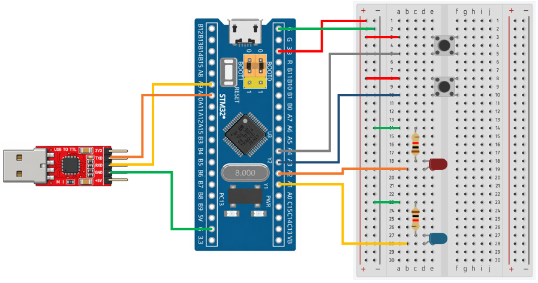

# FreeRTOS Project - Queue Set

這是一個基於 STM32F103C8T6 微控制器的 FreeRTOS 示例專案，，展示如何透過 Queue Set 同時監聽 Queue 與 Binary Semaphore

## 硬體需求

- STM32F103C8T6 微控制器 x1
- ST-Link 燒錄器
- USB-TTL 模組（專案使用 CP2102 模組）
- 按鈕 x2
- LED x2
- 220Ω 電阻 x2

## 軟體需求

- VSCode
- STM32CubeMX
- ARM GNU Toolchain
- CMake + Ninja
- STM32 HAL Library
- FreeRTOS
- 序列埠監控軟體（例如：串口調試助手）

## 電路圖

## 構建和編譯

1. 使用 VSCode 開啟專案資料夾
2. 確認 ARM GNU Toolchain 與 CMake 環境已正確設定
3. 執行 CMake Configure
4. 執行 Build
5. 使用 ST-Link 將程式燒錄至 STM32F103C8T6

## 使用方法

將程式燒錄至 STM32F103C8T6。當按下 KEY1 時，Task1 將資料寫入 Queue；當按下 KEY2 時，Task1 釋放 Binary Semaphore。Task2 透過 Queue Set 等待並判斷事件來源，如果收到 Queue 事件，則接收資料並翻轉 LED1 狀態；如果收到 Binary Semaphore 事件，則取得號誌並翻轉 LED2 狀態

## 任務介紹

- **Start Task**

  負責建立 Task1 與 Task2

- **Task1**

  負責偵測 KEY1 與 KEY2 的按鍵狀態，當按下 KEY1 時，將資料寫入 Queue；當按下 KEY2 時，釋放 Binary Semaphore

- **Task2**

  負責等待 Queue Set 中的事件，並根據事件來源執行對應操作。當成功接收 Queue 資料後，翻轉 LED1 狀態；當成功取得 Binary Semaphore 後，翻轉 LED2 狀態

## 功能介紹

- **Queue 資料傳送**

  使用 `xQueueSend()` 將資料寫入 Queue

- **Binary Semaphore 釋放**

  使用 `xSemaphoreGive()` 釋放二值號誌

- **Queue Set 事件等待**

  使用 `xQueueSelectFromSet()` 等待 Queue Set 中的事件，並取得可進行讀取或取得操作的成員 Handle