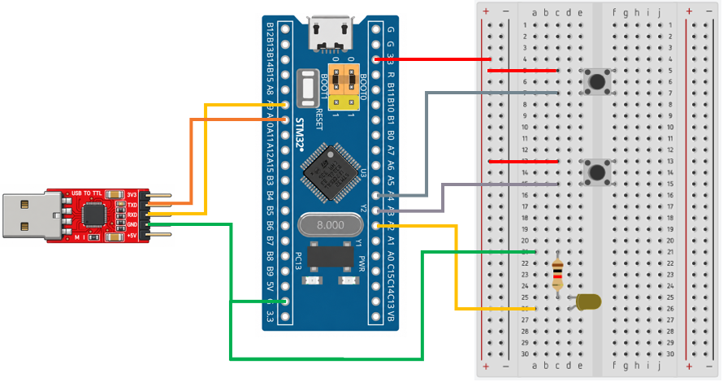

# FreeRTOS Project - Event Group

這是一個基於 STM32F103C8T6 微控制器的 FreeRTOS 示例專案，展示如何透過 Event Group 實現多事件等待與任務間同步

## 硬體需求

- STM32F103C8T6 微控制器 x1
- ST-Link 燒錄器
- USB-TTL 模組（專案使用 CP2102 模組）
- 按鈕 x2
- LED x1
- 220Ω 電阻 x1

## 軟體需求

- VSCode
- STM32CubeMX
- ARM GNU Toolchain
- CMake + Ninja
- STM32 HAL Library
- FreeRTOS
- 序列埠監控軟體（例如：串口調試助手）

## 電路圖

## 構建和編譯

1. 使用 VSCode 開啟專案資料夾
2. 確認 ARM GNU Toolchain 與 CMake 環境已正確設定
3. 執行 CMake Configure
4. 執行 Build
5. 使用 ST-Link 將程式燒錄至 STM32F103C8T6

## 使用方法

將程式燒錄至 STM32F103C8T6。當按下 KEY1 時，Task1 設定 BUTTON1 事件位元；當按下 KEY2 時，Task1 設定 BUTTON2 事件位元。Task2 透過 Event Group 等待 BUTTON1 與 BUTTON2 事件，當兩個事件位元皆被設定後，翻轉 LED 狀態

## 任務介紹

- **Start Task**

  負責建立 Task1 與 Task2

- **Task1**

  負責偵測 KEY1 與 KEY2 的按鍵狀態，當按下 KEY1 時，設定 BUTTON1 事件位元；當按下 KEY2 時，設定 BUTTON2 事件位元

- **Task2**

  負責等待 Event Group 中的 BUTTON1 與 BUTTON2 事件，當兩個事件位元皆被設定後，翻轉 LED 狀態

## 功能介紹

- **Event Group 事件設定**

  使用 `xEventGroupSetBits()` 設定 Event Group 中指定的事件位元

- **Event Group 事件等待**

  使用 `xEventGroupWaitBits()` 等待 BUTTON1 與 BUTTON2 事件位元，當兩個事件位元皆被設定後，解除阻塞並翻轉 LED 狀態